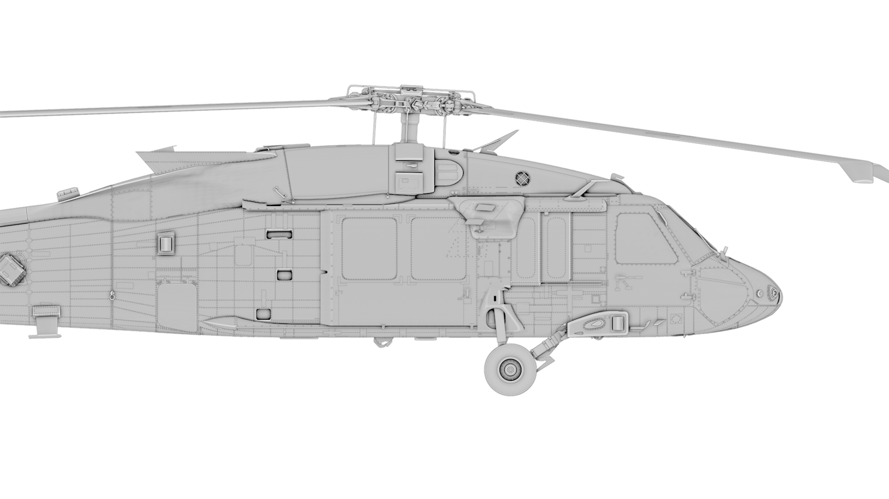
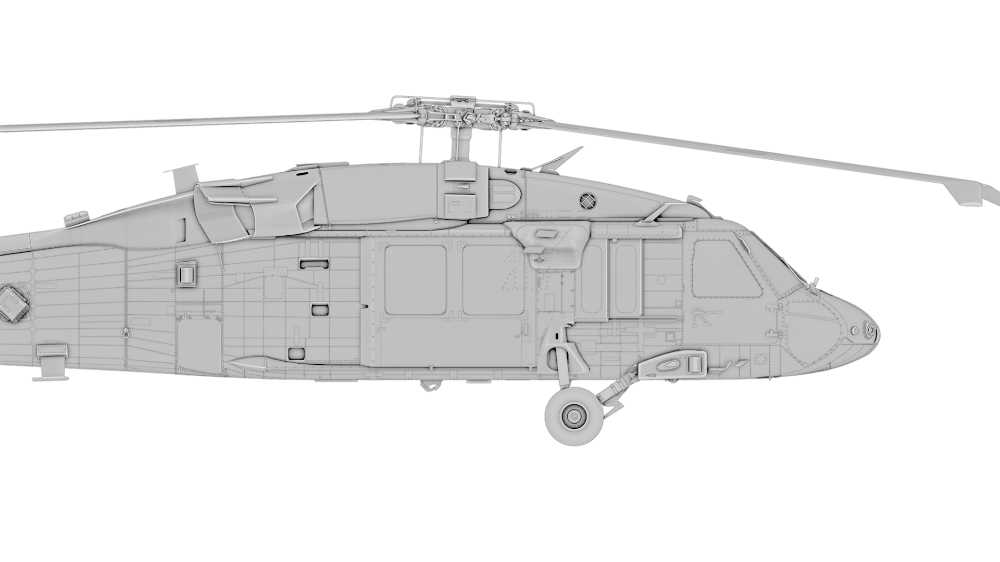
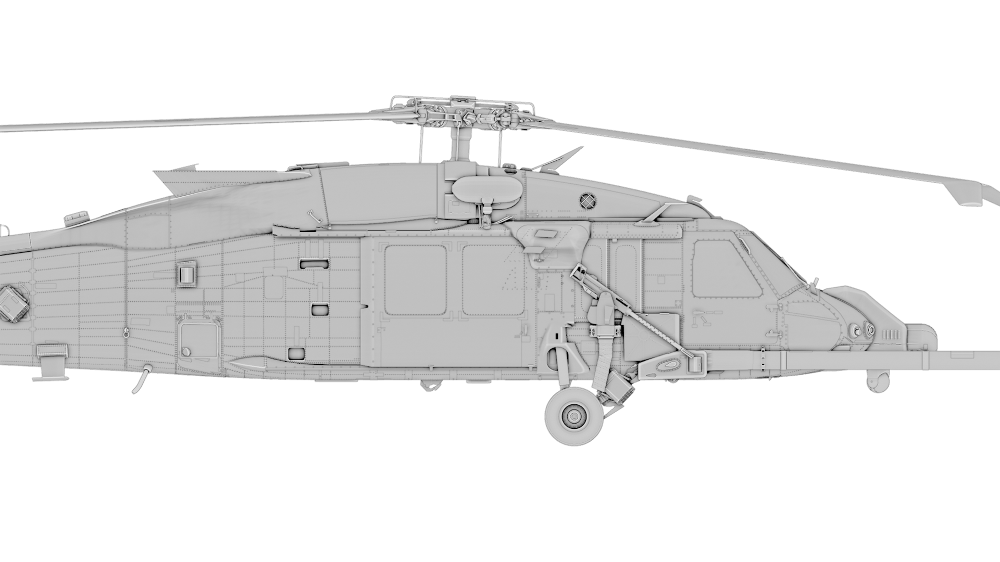
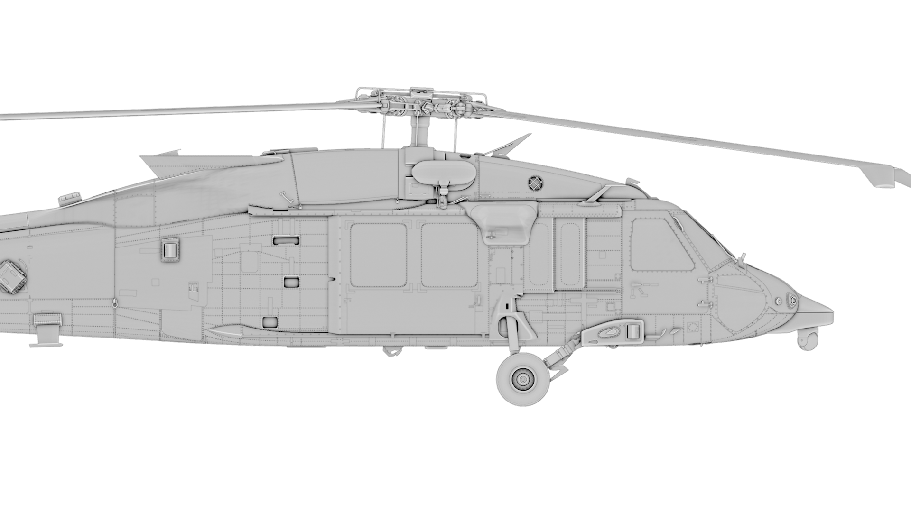
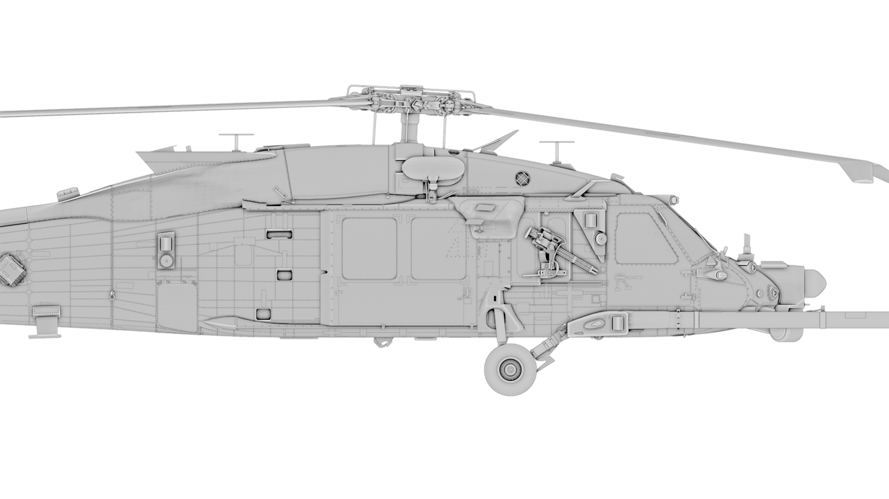
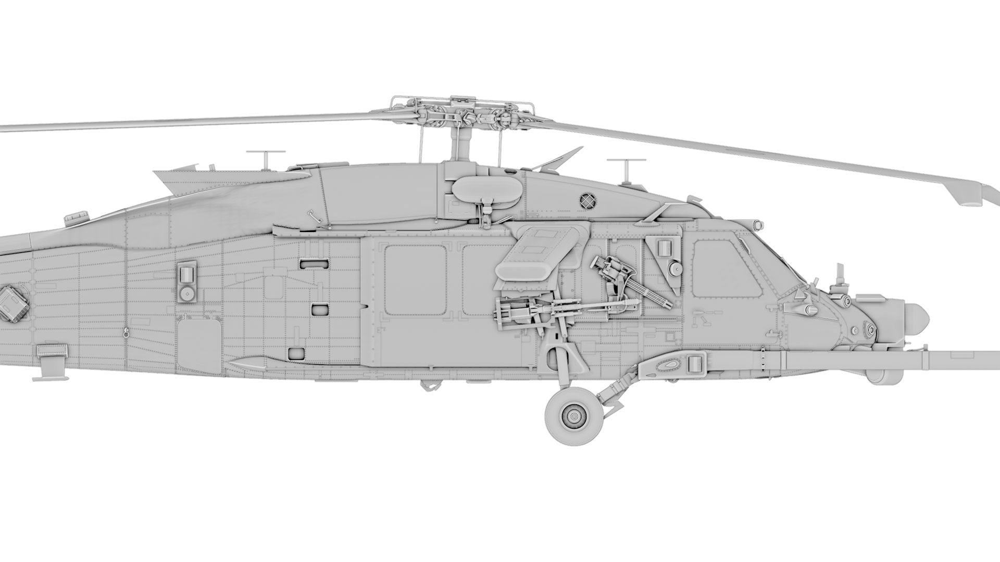
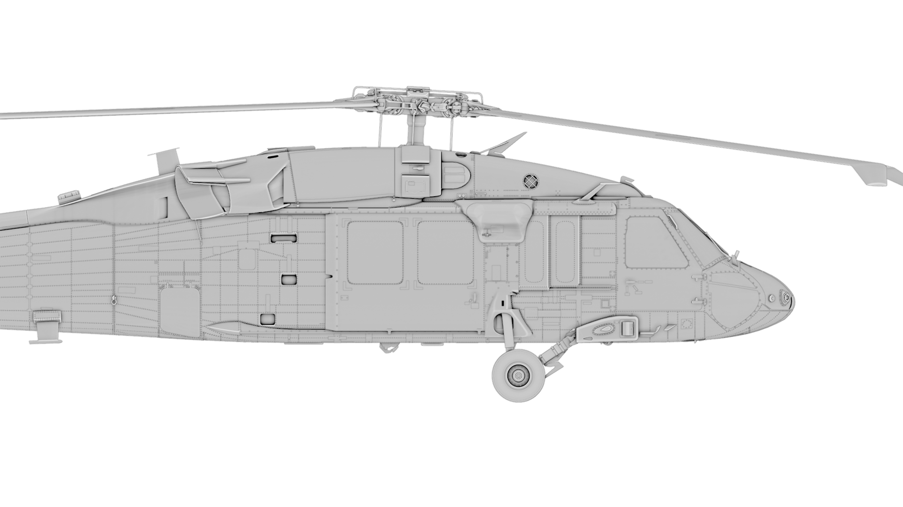
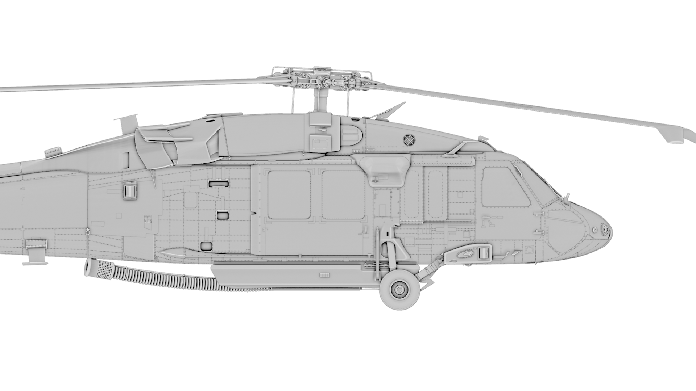

# Variants

=== "UH-60M "Mike""
    
    A base "Mike" model with UES, advanced flight control system, and upgraded rotor blades. Standard configuration for troop transport and utility missions.
    
    Also simulated is a HIRSS equipped Mike model.

=== "HH-60M "Dustoff""
    

    2 Pilots + 2 Crew with dedicated medical evacuation configuration, including integrated patient treatment system, equipped with an external rescue hoist.

=== "HH-60W "Jolly Green II""
    
    The US Air Force's newest Combat Search and Rescue (CSAR) helicopter featuring increased fuel capacity, advanced defensive systems, and improved armor protection for personnel recovery missions.

=== "HH-60U "Ghost Hawk""
    
    A byproduct of a test cycle, these rarely seen aircraft are used as a testbed for Skunkworks UH-60M modifications and security of the Groom Lake area.

=== "MH-60M "Night Stalker""
    
    Piloted exclusively by the U.S. Army's 160th Special Operations Aviation Regiment (SOAR), also known as the Night Stalkers, this special operations variant is equipped with several advanced sensors and capabilities to allow clandestine operations.
    
=== "MH-60M "DAP""
    
    The DAP - Direct Action Penetrator, is the weaponised variant of the 160th's MH-60M. Using external stores, it can be equipped with several weapons platforms.

=== "S-70i"
    
    The civilian/international export variant, this can be customized for global customers.
=== "S-70i "Helitak""
    
    The civilian/international export variant, eqipped with the Firetak aerial firefighting kit.

---
## Aircraft Overview

| Feature | Description |
|---------|-------------|
| Simulated Version | UH-60M "Mike" w/ UES |
| Crew | 2 Pilots + 2 Crew |
| Passengers | Up to 11 |
| Max Speed | 183 knots (211 mph) |
| Service Ceiling | 19,000 ft |
| Engines | 2 × T700-GE-701D Turboshaft |
