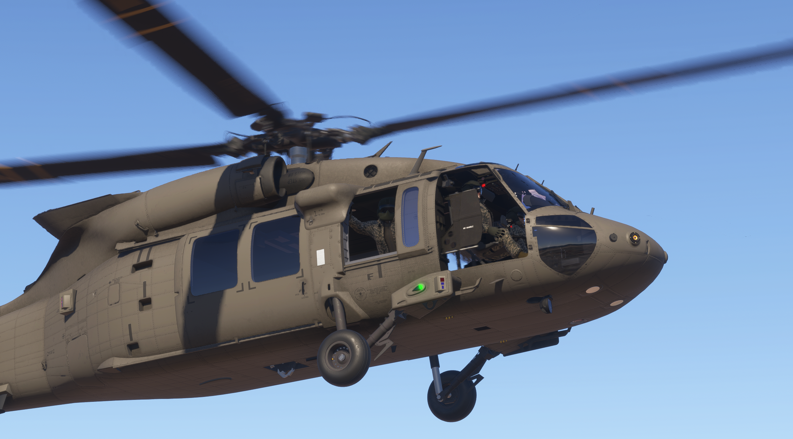

# Welcome to the UH-60M

Welcome to the **UH-60M Blackhawk** documentation for Delta Simulations. This guide will help you understand the aircraft systems, flight controls, and operational procedures.

---
## Overview

!!! warning "WARNING"
    **FOR SIMULATION USE ONLY**

    This documentation is intended for simulation purposes only, for use exclusively with the Delta Simulations UH-60M. This is not to be used in the real world.
!!! Example "Work in Progress"
    This documentation is an active work in progress, and is subject to change. Please report any issues on our Github, or on the Delta Simulations Discord Server. 
The **UH-60M Black Hawk** is a medium-lift utility helicopter used for
transport, medical evacuation, and special operations. This guide will help you learn the systems, features, and abilities this aircraft has.

We have simulated several variants of this aircraft, covering military to civilian uses.** [All Simulated Variants](../UH-60M/Aircraft%20and%20Systems/Simulated_Variants.md)**

To learn more, troubleshoot issues, and connect with our community, please join our Discord

[Join our Discord](https://discord.gg/4pjxYUw8j7){ .md-button }

---

## Getting Started
### Installation
Please follow the [Installation Instructions](/docs/faq.md#downloads) for the UH-60M. We highly recommend installing from our Github, as it will contain the most up-to-date releases.

### Aircraft and Systems
Before your first, flight, please familiarize yourself with the [Keybinds](/docs/UH-60M/Keybinds_Guide.md) of this aircraft.

Then, you can follow the [Quick Start Guide](/docs/UH-60M/Procedures/Quick%20Start%20Guide.md) for your first flight.

## Systems reference

These pages summarize the aircraft systems represented in the simulator:

- [Manual Reference and Scope](Aircraft%20and%20Systems/Manual%20Reference.md)
- [Flight Controls](Aircraft%20and%20Systems/Flight%20Controls.md)
- [Powerplant and Fuel](Aircraft%20and%20Systems/Powerplant%20and%20Fuel.md)
- [Electrical and Hydraulic Systems](Aircraft%20and%20Systems/Electrical%20and%20Hydraulic%20Systems.md)
- [Display Systems](Aircraft%20and%20Systems/Display%20Systems.md)
- [Utility and Mission Equipment](Aircraft%20and%20Systems/Utility%20and%20Mission%20Equipment.md)
